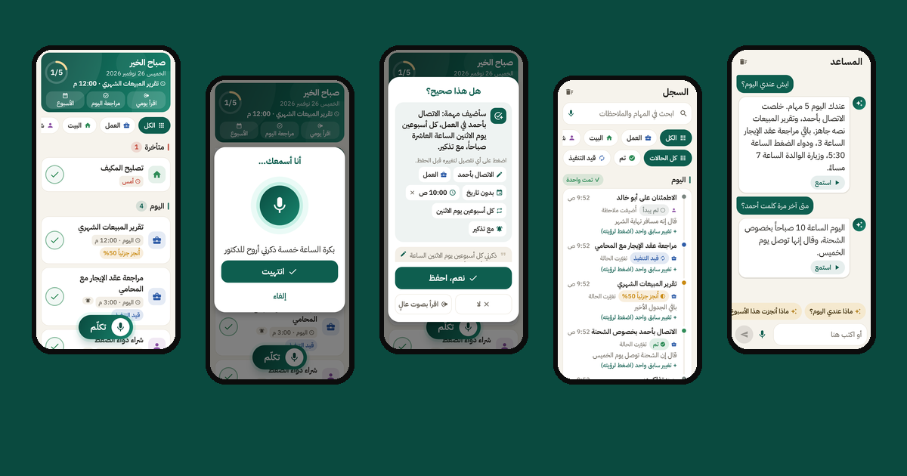
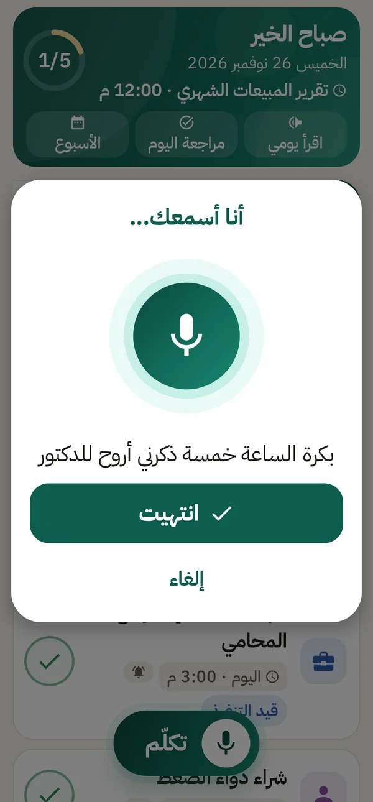
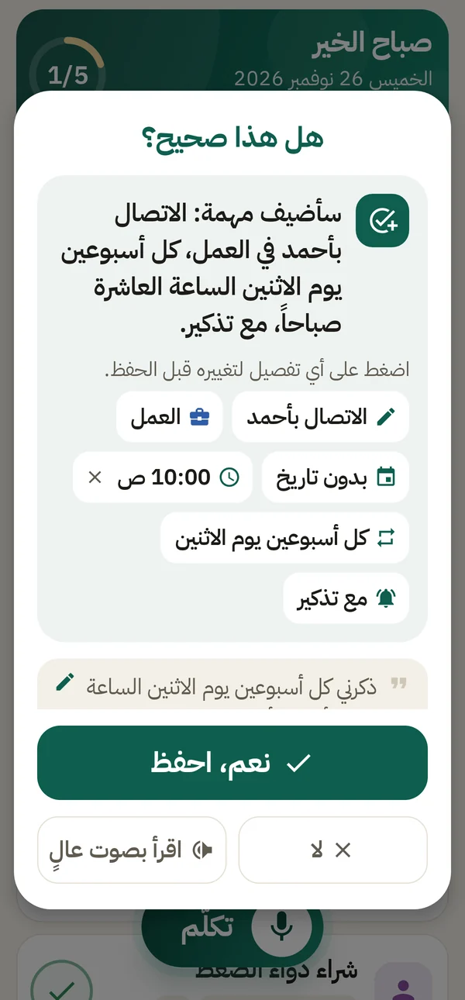
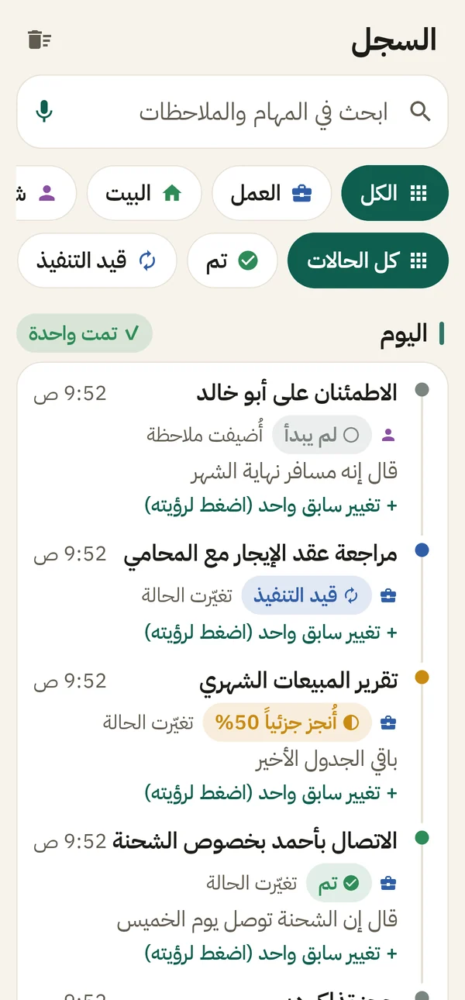

# Smart To-Do · مهامي الذكية

**An Android to-do list you talk to in Arabic.** Say what you must do, in any dialect. It writes it
down, files it, reminds you on time, asks how it went, and keeps the whole record, so you can later
ask *"when did I last call Ahmed?"*.

**[Download for Android](https://kiraherk.github.io/Smart-To-Do/)** · free · open source · Android 8+

Designed and developed by **Hussein Al Herk** ([@KIRAHERK](https://github.com/KIRAHERK)).

## Why it exists

It was made for a busy businessman who wrote his daily and weekly lists on paper and threw them
away, so nothing was kept and things were forgotten. He would rather speak than type. Smart To-Do
lets him talk, confirms what it understood, and never loses a word.

## What you can say

No commands to learn. It understands plain speech, reads back what it understood, and saves only
when you say yes. Every detail (name, category, day, time, repeat, reminder) can be tapped and
changed first.

| | Say | Meaning |
|---|---|---|
| Add | «بكرة الساعة عشرة أتصل بالبنك» | Tomorrow at ten, call the bank. |
| Repeat | «ذكرني كل أسبوعين أطمّن على أبو خالد» | Remind me every two weeks to check on Abu Khaled. |
| Update | «تقرير المبيعات خلصت نصه، باقي الجدول الأخير» | Half the sales report is done; the last table is left. |
| Postpone | «ما قدرت أروح للبنك اليوم، أجّلها لبكرة» | Couldn't get to the bank today, move it to tomorrow. |
| Note | «على مهمة الشحنة: أحمد قال توصل يوم الخميس» | On the shipment task: Ahmed says it arrives Thursday. |
| Ask | «متى آخر مرة كلمت أحمد؟» | When did I last call Ahmed? |

More examples are in the Arabic user guide, [docs/USER_GUIDE_ar.md](docs/USER_GUIDE_ar.md).

## What it does

- **Today:** what is late, due today and coming up, coloured by category: Work, Home, Personal,
  Travel, plus your own.
- **Statuses that match real life:** not started, in progress, partly done (with %), done, done
  with a note, not done, postponed, cancelled, and *missed* for a repeating round that passed.
- **Reminders and repeats:** "every two weeks", "every month on the 15th", "every Friday". Each
  reminder has *Done*, *Partly* and *In an hour* buttons.
- **Daily rhythm:** a morning summary read aloud, an evening review ("how was your day?") and a
  Friday weekly review, all answered by voice.
- **History:** every task once, with its current status and every earlier change. Filter by status
  or category, search by voice or text (Arabic-aware: أحمد = احمد), select and delete.
- **Assistant:** a chat that knows your tasks, notes and history. Answers are read aloud with a
  play / pause button.
- **Nothing is lost:** speech said offline is kept and added by itself when Wi-Fi or data returns.
  Daily backups, a backup before every update, share and restore.
- **Updates itself** from this repository's releases and keeps all data.
- Large text, high contrast, right-to-left Arabic (English also available), a short guide on first
  run and after updates.

<p>





</p>

## Install

1. On the phone, open the [download page](https://kiraherk.github.io/Smart-To-Do/) (or the
   [latest release](../../releases/latest)) and download `SmartToDo-vX.Y.Z.apk`.
2. Open it, and allow "Install unknown apps" when Android asks.
3. Follow the setup list in the app: microphone, notifications, battery, then paste a free Gemini
   API key from [Google AI Studio](https://aistudio.google.com/apikey) once.

New versions then appear inside the app (Settings → Updates, plus a daily check). The full
step-by-step guide, including the signing key and releasing, is in [docs/SETUP.md](docs/SETUP.md).

## How it is built

| Part | Technology |
|---|---|
| App | Kotlin, Jetpack Compose, Material 3, minSdk 26 (Android 8.0+) |
| Speech to text | Android `SpeechRecognizer` (Arabic dialect chosen in Settings), or recording + Gemini transcription so long pauses never cut him off |
| Text to speech | Android `TextToSpeech`, or Google's natural voices when online |
| Understanding and assistant | Google **Gemini API**, free tier, over REST. The newest free *flash-lite* / *flash* model is picked from the live model list, with automatic fallback when a daily limit is reached. One request per command. |
| Storage | Room (SQLite) with exported schemas and explicit migrations |
| Reminders | `AlarmManager` exact alarms, rescheduled after a reboot |
| Offline | A queue of unprocessed speech, retried when the network returns |
| Updates | GitHub Releases + in-app installer that checks the APK is signed with the same key |

The Gemini API key is **never** in this repository or the APK. It is typed into the app once and
stored encrypted with the Android Keystore.

## Build from source

Requirements: JDK 17+, Android SDK (platform 37, build-tools 36).

```bash
./gradlew assembleDebug testDebugUnitTest lintDebug
```

The debug build installs as a separate app (`io.github.kiraherk.smarttodo.debug`), so testing never
touches real data. `ScreenshotTest` renders the main screens to `app/build/screenshots/`, and
`StoreScreenshotTest` renders the clean screens used here and on the download page to
`app/build/store-screenshots/`. Emulator tests run on Android 8 and 10 in CI.

Releases are built by GitHub Actions (`.github/workflows/release.yml`) with the signing key kept in
repository secrets. See [docs/SETUP.md](docs/SETUP.md#releasing-a-new-version). The download page
is `docs/index.html`, served by GitHub Pages.

### Rules that keep his data safe across updates

- Never change `applicationId` (`io.github.kiraherk.smarttodo`) or the signing key.
- Every database change bumps `AppDatabase.VERSION`, adds a `Migration`, and commits the new
  schema JSON in `app/schemas/`. `SchemaGuardTest` fails the build otherwise.
- Never use `fallbackToDestructiveMigration`.
- Only add fields to `RecurrenceRule` / backup classes, with default values.

## Privacy

Tasks are stored only on the phone. Text is sent to Google's Gemini API only to understand a
command or answer a question. On the free tier Google may use this content to improve its
products, so don't dictate passwords or bank details.

## About the developer

Smart To-Do is designed, built and maintained by **Hussein Al Herk**.

- Portfolio: [kiraherk.github.io](https://kiraherk.github.io)
- LinkedIn: [husseinalherk](https://www.linkedin.com/in/husseinalherk)
- GitHub: [@KIRAHERK](https://github.com/KIRAHERK)

## Credits

The idea, the design decisions and the testing on real phones: Hussein Al Herk. If you use or
build on this project, please keep this credit (see [NOTICE](NOTICE)).

Typefaces, all under the SIL Open Font License 1.1: IBM Plex Sans Arabic in the app
([third_party/fonts](third_party/fonts/IBM-Plex-Sans-Arabic-OFL.txt)); IBM Plex, El Messiri and
Noto Naskh Arabic on the download page ([docs/licenses](docs/licenses)). AI: Google Gemini API.

## License

[Apache License 2.0](LICENSE). Copyright (c) 2026 Hussein Al Herk.
