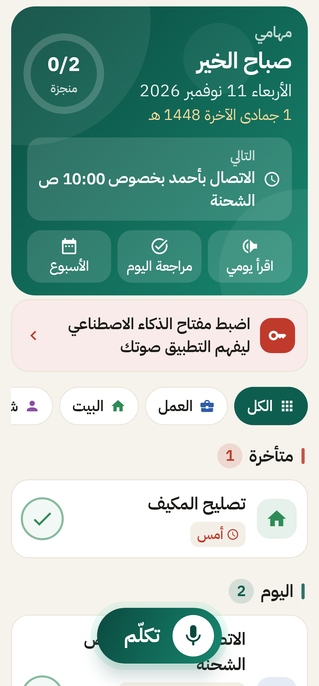
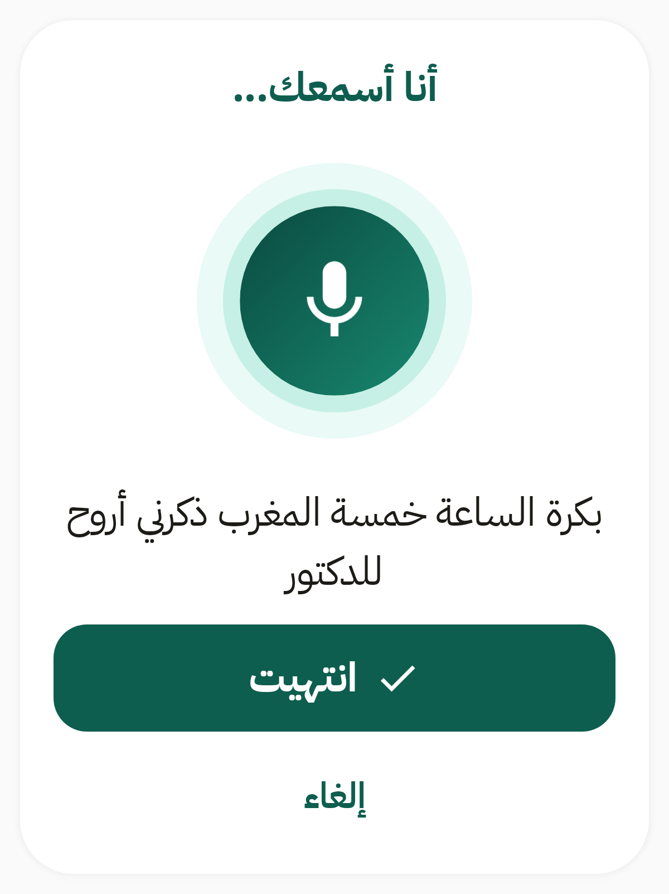
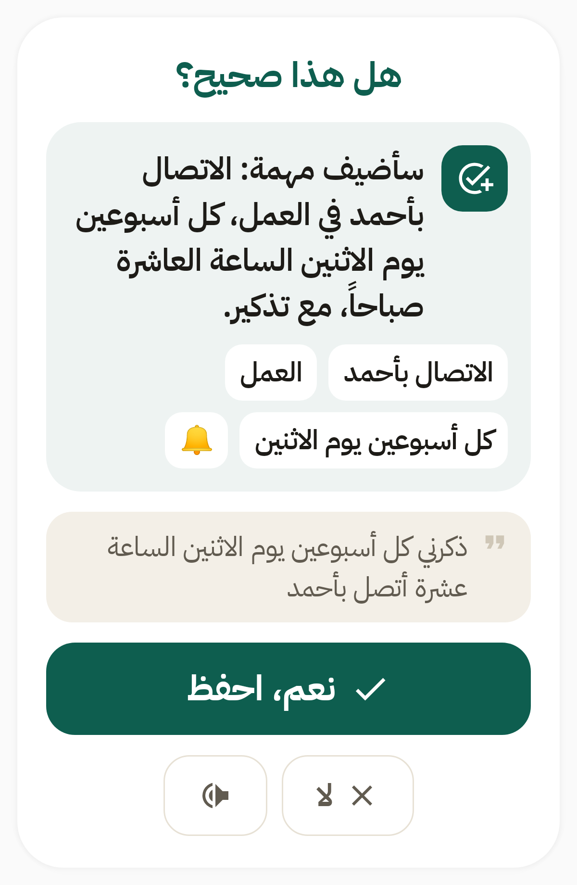
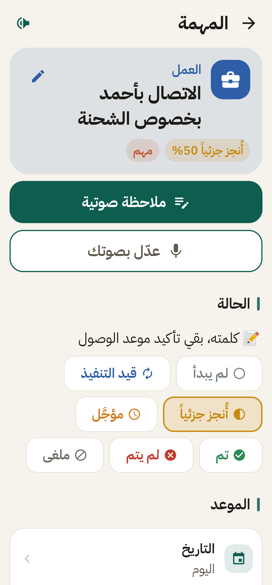

# Smart To-Do · مهامي الذكية

An open-source Android to-do app you **talk to in Arabic** instead of typing.
Made for a busy businessman who used to write his lists on paper: now every task, note and
status change is kept forever, reminders ring on time, and an assistant can answer
questions like *"when did I last call Ahmed?"*.

<p>




</p>

## What it does

- **Voice first.** Press the big «تكلّم» button and speak naturally, in any Arabic dialect:
  *«ذكرني كل أسبوعين يوم الاثنين الساعة عشرة أتصل بأحمد»*. The app shows and reads back what it
  understood and saves it when you say yes.
- **Organised automatically** into Work · Home · Personal · Travel.
- **Statuses that match real life:** not started, in progress, partly done (with %), done,
  done with a note, not done, postponed, cancelled, and *missed* for a repeating round that passed.
- **Notes by voice** on any task, any time.
- **Reminders and repeats:** "every two weeks", "every month on the 15th", "every Friday"…
  Reminders ring exactly on time and have *Done / Partly / In 1 hour* buttons.
- **Change repeating tasks by voice:** "make the Ahmed call monthly", "postpone it to Thursday".
- **Full history:** every change is logged with date and time; search by voice or text
  (Arabic-aware: أحمد = احمد, مدرسة = مدرسه…).
- **Daily rhythm:** morning summary (read aloud), evening review ("tell me what you did"),
  weekly review.
- **Assistant:** ask anything about your tasks, notes and history; answers are read aloud.
- **Nothing is ever lost:** if there is no internet or AI, what you said goes to the Inbox and
  is organised later. Automatic daily backups, a backup before every update, share / restore.
- **Updates itself** from this repository's GitHub Releases, keeping all data.
- Large text, high contrast, Arabic right-to-left interface (English also available).

## How it works

| Part | Technology |
|---|---|
| App | Kotlin, Jetpack Compose, Material 3, minSdk 26 (Android 8.0+) |
| Speech → text | Android `SpeechRecognizer` (Google's engine, Arabic dialect chosen in Settings) |
| Text → speech | Android `TextToSpeech` |
| Understanding & assistant | Google **Gemini API**, free tier, via REST. The best free *flash-lite* / *flash* model is picked from the live model list, with automatic fallback when a daily limit is reached. One request per command. |
| Storage | Room (SQLite) with exported schemas and explicit migrations |
| Reminders | `AlarmManager` exact alarms, rescheduled after reboot |
| Updates | GitHub Releases + in-app installer (verifies the APK is signed with the same key) |

The Gemini API key is **never** in this repository or the APK. It is typed into the app's
Settings once and stored encrypted with the Android Keystore.

## Install

1. On the phone, open the [latest release](../../releases/latest) and download `SmartToDo-vX.Y.Z.apk`.
2. Open it, allow "Install unknown apps" for the browser when asked, and install.
3. Follow the setup checklist in the app (microphone, notifications, battery, Gemini key).

After that, new versions appear inside the app (Settings → Check for updates, plus a daily
notification). See **[docs/SETUP.md](docs/SETUP.md)** for the full step-by-step guide and
**[docs/USER_GUIDE_ar.md](docs/USER_GUIDE_ar.md)** for the Arabic user guide.

## Build from source

Requirements: JDK 17+, Android SDK (platform 37, build-tools 36).

```bash
./gradlew assembleDebug testDebugUnitTest lintDebug
```

The debug build installs as a separate app (`io.github.kiraherk.smarttodo.debug`), so testing
never touches real data. `ScreenshotTest` renders the main screens to `app/build/screenshots/`.

Releases are built by GitHub Actions (`.github/workflows/release.yml`) with the signing key
stored in repository secrets. See [docs/SETUP.md](docs/SETUP.md#releasing-a-new-version).

### Rules that keep his data safe across updates

- Never change `applicationId` (`io.github.kiraherk.smarttodo`) or the signing key.
- Every database change bumps `AppDatabase.VERSION`, adds a `Migration`, and commits the new
  schema JSON in `app/schemas/`. `SchemaGuardTest` fails the build otherwise.
- Never use `fallbackToDestructiveMigration`.
- Only add fields to `RecurrenceRule` / backup classes, with default values.

## Privacy

Tasks are stored only on the phone. Text is sent to Google's Gemini API only to understand a
command or answer a question. On the free tier Google may use this content to improve its
products, so don't dictate passwords or bank details.

## License

[Apache License 2.0](LICENSE).

The app bundles the IBM Plex Sans Arabic font, licensed under the SIL Open Font License 1.1
([third_party/fonts](third_party/fonts/IBM-Plex-Sans-Arabic-OFL.txt)).
