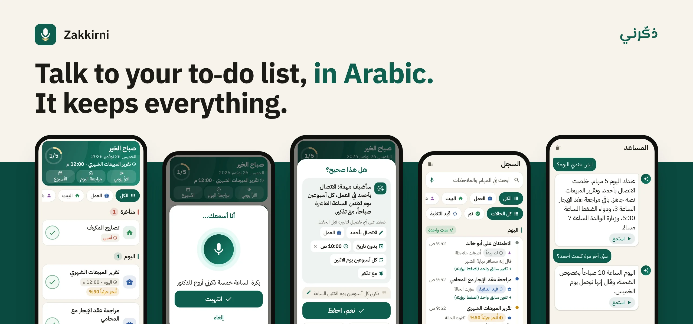
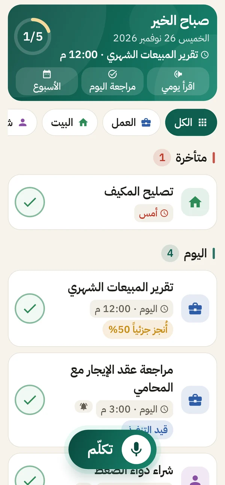
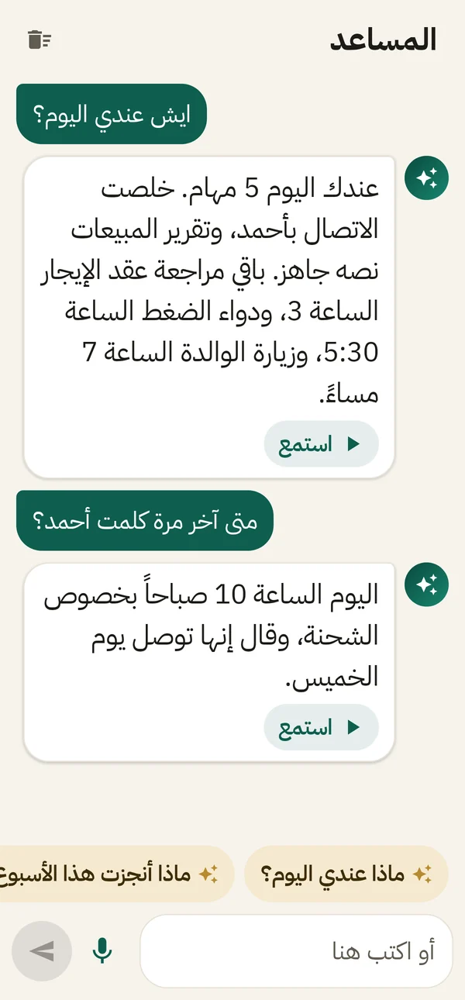

<a href="https://kiraherk.github.io/Smart-To-Do/"></a>

<p align="center">
  <a href="https://kiraherk.github.io/Smart-To-Do/"></a>
</p>

<p align="center">
  Free · open source · Android 8 and newer<br>
  <a href="https://kiraherk.github.io/Smart-To-Do/">Website</a> ·
  <a href="../../releases/latest">Latest release</a> ·
  <a href="docs/USER_GUIDE_ar.md">دليل الاستخدام</a> ·
  <a href="docs/SETUP.md">Setup guide</a>
</p>

<p align="center"><sub>Designed and developed by <b>Hussein Al Herk</b> · <a href="https://kiraherk.github.io">Portfolio</a> · <a href="https://www.linkedin.com/in/husseinalherk">LinkedIn</a> · <a href="https://github.com/KIRAHERK">GitHub</a></sub></p>

---

Say what you must do, in any Arabic dialect. Smart To-Do writes it down, files it, reminds you
on time, asks how it went, and keeps the whole record, so later you can simply ask
*«متى آخر مرة كلمت أحمد؟»* (when did I last call Ahmed?).

It was made for a busy businessman who wrote his lists on paper and threw them away, so nothing
was kept and things were forgotten. He would rather speak than type.

## The app

<table>
  <tr>
    <td align="center" width="20%"></td>
    <td align="center" width="20%"></td>
    <td align="center" width="20%"></td>
    <td align="center" width="20%"></td>
    <td align="center" width="20%"></td>
  </tr>
  <tr>
    <td align="center"><b>Today</b><br><sub>Late, today, coming up</sub></td>
    <td align="center"><b>Talk</b><br><sub>Any dialect, no time limit</sub></td>
    <td align="center"><b>Confirm</b><br><sub>Fix any detail first</sub></td>
    <td align="center"><b>History</b><br><sub>Every change, kept</sub></td>
    <td align="center"><b>Assistant</b><br><sub>Ask about your tasks</sub></td>
  </tr>
</table>

## Say it the way you'd say it

No commands to learn. It reads back what it understood and saves only when you say yes.

| | You say | It understands |
|---|---|---|
| **Add** | «بكرة الساعة عشرة أتصل بالبنك» | Tomorrow at ten, call the bank. |
| **Repeat** | «ذكرني كل أسبوعين أطمّن على أبو خالد» | Every two weeks, check on Abu Khaled. |
| **Update** | «تقرير المبيعات خلصت نصه، باقي الجدول الأخير» | Sales report half done; last table left. |
| **Postpone** | «ما قدرت أروح للبنك اليوم، أجّلها لبكرة» | Move the bank to tomorrow. |
| **Note** | «على مهمة الشحنة: أحمد قال توصل يوم الخميس» | Note on the shipment task. |
| **Ask** | «متى آخر مرة كلمت أحمد؟» | When did I last call Ahmed? |

## Nothing gets lost

<table>
  <tr>
    <td width="50%" valign="top"><b>Every change is kept</b><br>Each status and note is dated. Search by voice or text, filter History by status or category, select and delete.</td>
    <td width="50%" valign="top"><b>Works without internet</b><br>What you say offline is saved and added by itself as soon as Wi-Fi or data is back.</td>
  </tr>
  <tr>
    <td valign="top"><b>It asks how it went</b><br>A morning summary read aloud, an evening review and a Friday weekly review, all answered by voice.</td>
    <td valign="top"><b>Reminders that ring on time</b><br>"Every two weeks", "every month on the 15th", with <i>Done</i>, <i>Partly</i> and <i>In an hour</i> buttons.</td>
  </tr>
  <tr>
    <td valign="top"><b>No surprises</b><br>Nothing is saved or deleted without your yes, and a deleted task can be brought back.</td>
    <td valign="top"><b>Updates itself</b><br>New versions install over the old one from inside the app, with a backup before every update and one every day.</td>
  </tr>
</table>

Statuses match real life: not started, in progress, partly done (with %), done, done with a note,
not done, postponed, cancelled, and *missed* for a repeating round that passed. Large text, high
contrast, right-to-left Arabic, English available, and a short guide on first run.

## Install in a minute

1. Open the [website](https://kiraherk.github.io/Smart-To-Do/) on the phone and tap **Download for Android**.
2. Open the file and allow "Install unknown apps" when Android asks.
3. Follow the setup list: microphone, notifications, battery, then paste a free Gemini key from
   [Google AI Studio](https://aistudio.google.com/apikey) once (two minutes, no card needed).

Later versions arrive inside the app.

<div dir="rtl">

## بالعربية

**مهامي الذكية** تطبيق مهام تتكلم معه بصوتك بدل الكتابة. قل ما عليك فعله بلهجتك، فيكتبه
ويصنّفه ويذكّرك في وقته، ويسألك كيف جرى، ويحفظ السجل كاملاً. إذا لم يكن هناك إنترنت يُحفظ
كلامك ويُضاف وحده عند عودة الاتصال. مجاني ومفتوح المصدر، لأندرويد 8 وأحدث.

[تنزيل التطبيق](https://kiraherk.github.io/Smart-To-Do/?lang=ar) · [دليل الاستخدام](docs/USER_GUIDE_ar.md)

</div>

## For developers

<details>
<summary><b>How it is built</b></summary>

| Part | Technology |
|---|---|
| App | Kotlin, Jetpack Compose, Material 3, minSdk 26 (Android 8.0+) |
| Speech to text | Android `SpeechRecognizer` (dialect chosen in Settings), or recording + Gemini transcription so long pauses never cut him off |
| Text to speech | Android `TextToSpeech`, or Google's natural voices when online |
| Understanding and assistant | Google **Gemini API**, free tier, over REST. The newest free *flash-lite* / *flash* model is picked from the live model list, with automatic fallback when a daily limit is reached. One request per command. |
| Storage | Room (SQLite) with exported schemas and explicit migrations |
| Reminders | `AlarmManager` exact alarms, rescheduled after a reboot |
| Offline | A queue of unprocessed speech, retried when the network returns |
| Updates | GitHub Releases + in-app installer that checks the APK is signed with the same key |

The Gemini API key is **never** in this repository or the APK. It is typed into the app once and
stored encrypted with the Android Keystore.

</details>

<details>
<summary><b>Build from source</b></summary>

Requirements: JDK 17+, Android SDK (platform 37, build-tools 36).

```bash
./gradlew assembleDebug testDebugUnitTest lintDebug
```

The debug build installs as a separate app (`io.github.kiraherk.smarttodo.debug`), so testing never
touches real data. `ScreenshotTest` renders the main screens to `app/build/screenshots/`, and
`StoreScreenshotTest` renders the clean screens used here and on the website to
`app/build/store-screenshots/`. Emulator tests run on Android 8 and 10 in CI.

Releases are built by GitHub Actions (`.github/workflows/release.yml`) with the signing key kept in
repository secrets; see [docs/SETUP.md](docs/SETUP.md#releasing-a-new-version). The website is
`docs/index.html`, published to GitHub Pages by `.github/workflows/pages.yml`.

</details>

<details>
<summary><b>Rules that keep his data safe across updates</b></summary>

- Never change `applicationId` (`io.github.kiraherk.smarttodo`) or the signing key.
- Every database change bumps `AppDatabase.VERSION`, adds a `Migration`, and commits the new
  schema JSON in `app/schemas/`. `SchemaGuardTest` fails the build otherwise.
- Never use `fallbackToDestructiveMigration`.
- Only add fields to `RecurrenceRule` / backup classes, with default values.

</details>

## Privacy

Tasks are stored only on the phone. Text is sent to Google's Gemini API only to understand a
command or answer a question. On the free tier Google may use this content to improve its
products, so don't dictate passwords or bank details.

## Credits

Smart To-Do is designed, built and maintained by **Hussein Al Herk**
([portfolio](https://kiraherk.github.io), [LinkedIn](https://www.linkedin.com/in/husseinalherk),
[@KIRAHERK](https://github.com/KIRAHERK)): the idea, the design decisions and the testing on real
phones. If you use or build on this project, please keep this credit (see [NOTICE](NOTICE)).

Typefaces, all under the SIL Open Font License 1.1: IBM Plex Sans Arabic in the app
([third_party/fonts](third_party/fonts/IBM-Plex-Sans-Arabic-OFL.txt)); IBM Plex, El Messiri and
Noto Naskh Arabic on the website ([docs/licenses](docs/licenses)). AI: Google Gemini API.

## License

[Apache License 2.0](LICENSE). Copyright (c) 2026 Hussein Al Herk.
